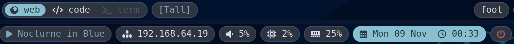
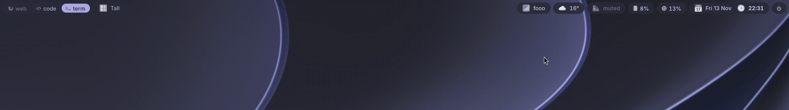

# waymobar

A status bar for Wayland, written and configured in Haskell, in the spirit of
xmobar. It is the native bar for [rivermonad](https://github.com/prietus/rivermonad):
workspaces, layout and window title come straight from rivermonad's IPC
socket, and clicking them acts on rivermonad.





*The pill theme from the [example dotfiles](https://github.com/prietus/rivermonad/tree/main/examples/dotfiles)
at scale 2: hover highlights, workspaces and layouts switched by clicking.
See it in a whole desktop in [rivermonad's demo](https://github.com/prietus/rivermonad#rivermonad).*

* pure-Haskell Wayland client (`Waymobar.Wayland.Wire`, bindings generated
  from the XML in `protocol/`); text is drawn with cairo + pango through a
  small FFI, no GTK
* wlr-layer-shell surface on every output (follows hotplug), with an
  exclusive zone so tiled windows avoid it
* HiDPI: fractional scaling (`wp_fractional_scale_v1` + `wp_viewporter`), or
  integer buffer scale on compositors without it
* mouse: clicks and the wheel, cursor via `wp_cursor_shape_v1`
* system tray (StatusNotifierItem: nm-applet, Telegram, Steam, Discord,
  KDE and Qt apps, Electron, libappindicator...), with their menus shown as
  native popups; a small pure-Haskell D-Bus client, no libdbus
* popup menus for your own widgets too (`clickMenu`)
* reconnects by itself when rivermonad restarts (`mod-q`)
* works on any compositor with layer-shell (the rivermonad widgets just stay
  empty elsewhere)

## Build

```sh
sudo apt install libcairo2-dev libpango1.0-dev libgdk-pixbuf-2.0-dev libpulse-dev   # plus ghc and cabal-install
cd waymobar
cabal install --lib waymobar      # so ghc can compile your config
cabal install exe:waymobar
```

Start it from your rivermonad config:

```haskell
startupHook = spawnOnce "waymobar"
```

## Configuration

Without a configuration `waymobar` shows the default bar: workspaces and
layout on the left, window title in the middle, CPU, memory, battery and
tray and clock on the right. To change it, write `~/.config/waymobar/waymobar.hs`
(see [examples/waymobar.hs](examples/waymobar.hs)):

```haskell
import Waymobar

main :: IO ()
main = waymobar def
  { font = "JetBrains Mono 10"
  , position = Bottom
  , left = [ workspaces defaultWorkspaces { hideEmpty = True } ]
  , right = [ cpu (\p -> "cpu " ++ show p ++ "%"), clock "%H:%M" ]
  }
```

Like xmonad, `waymobar` rebuilds the file when it changes and runs the
result; `waymobar --recompile` checks it. An executable
`~/.config/waymobar/build` script, if present, is used instead of ghc, with
the output path as `$1` (same convention as rivermonad, e.g. to build with
`cabal exec` against a checkout).

### `Config`

| Field | Default | |
|---|---|---|
| `font` | `"monospace 10"` | pango font description |
| `barHeight` | `0` | logical pixels; 0 = fit the font |
| `position` | `Top` | or `Bottom` |
| `layer` | `TopLayer` | `BackgroundLayer`, `BottomLayer`, `OverlayLayer` |
| `exclusive` | `True` | reserve the bar's space |
| `margins` | `(0, 0, 0, 0)` | space around the bar (top, right, bottom, left); `(0, 1, 0, 1)` lines it up with rivermonad's `gapsWithEdge 1` |
| `bgColor`, `fgColor` | Nord | `#rgb`, `#rrggbb`, `#rrggbbaa` |
| `left`, `center`, `right` | | lists of widgets |
| `widgetSpacing`, `edgePadding` | `12`, `4` | pixels |
| `outputs` | `[]` | only these outputs (`["DP-1"]`); `[]` = all |
| `namespace` | `"waymobar"` | layer-shell namespace |

### Widgets

| Widget | |
|---|---|
| `workspaces cfg` | one clickable block per rivermonad workspace; the wheel cycles them |
| `layoutName fmt` | layout of the workspace on this output; click = next layout |
| `logoutButton label` | asks for confirmation, then logs out gracefully: windows are asked to close, and the session ends (back to GDM) once they have; cancelled if one refuses |
| `windowTitle n` | focused window's title, cut to `n` characters |
| `clock fmt` | `formatTime` format, updated on the second |
| `cpu f`, `memory f` | percentages, `f :: Int -> String` |
| `battery f` | `f :: Int -> String -> String` (capacity, status) |
| `command cmd secs` | first line of a shell command, every `secs` seconds |
| `commandReader cmd` | last line printed by a long-running command (markup) |
| `tray defaultTray` | system tray (see below) |
| `volume f` | volume of the default output, live (see below) |
| `network secs f` | connection, Wi-Fi network and signal, IP, traffic |
| `mpris f` | the current media player (see below) |
| `text markup` | fixed text |
| `periodic secs io` | any `IO String` (`readCommand` gives a command's first line) |

`WorkspacesConfig` (start from `defaultWorkspaces`) has `wsLabel`,
`focusedStyle`, `activeStyle` (shown on this bar's output), `visibleStyle`
(on another output), `hiddenStyle`, `emptyStyle`, `hideEmpty`, `wsPadding`,
`clickAction` (default `FocusWorkspace . wsName`; `ViewWorkspace` for
greedyView) and `scrollCycles`.

Combinators: `colored "#hex"`, `withStyle`, `padded n`, `markup f`,
`onClick (\c -> ...)`, `spawnOnClick "cmd"`. Text is pango markup; use
`escape` for untrusted strings.

### Icons

Two kinds, both sharp at any output scale:

* **Icon fonts.** Text is drawn with pango, so any glyph of an installed
  font works in any widget: emoji (`"🔊 "`) or [Nerd Fonts](https://www.nerdfonts.com)
  symbols (`"\xf028 "`). With the "Symbols Nerd Font" installed (the
  symbols-only package) fontconfig picks the glyphs from it automatically,
  whatever your text font is. They take the text colour.
* **Images.** SVG, PNG… files or freedesktop theme icons, rasterized when
  the bar is drawn at the output's real pixel size (cached), so an SVG is
  not blurred on HiDPI outputs. SVG needs gdk-pixbuf's loader
  (`librsvg2-common` on Debian/Ubuntu).

| | |
|---|---|
| `icon "name-or-path"` | just an icon |
| `withIcon "name-or-path" w` | an icon before the widget's text |
| `iconColor "#hex" w` | recolour all its icons (monochrome SVGs) |
| `withIconSize px w` | icon size in logical pixels (default: bar height − 8) |

A path (anything with a `/`, `~/...`, or an image extension) is a file;
anything else is looked up in the icon theme, e.g.
`withIcon "audio-volume-high-symbolic" volume`. `-symbolic` icons take
the text colour. Tray icons from the theme use the same mechanism.

### Styling

Instead of CSS, a `Style` (every field optional) says how a block looks;
the waybar equivalents are in the comments:

```haskell
pill :: Style
pill = noStyle
  { styleFg      = Just "#d8dee9"            -- color
  , styleBg      = Just "#2e3440"            -- background
  , styleBorder  = Just (1, "#434c5e")       -- border: 1px solid
  , styleRadius  = Just 12                   -- border-radius
  , styleMargin  = Just (3, 0)               -- margin: 3px 0 (vertical, horizontal)
  , stylePadding = Just 10                   -- padding: 0 10px
  , styleHover   = Just noStyle { styleBg = Just "#3b4252" }   -- :hover
  }
```

`styleUnderline`/`styleOverline` draw a 2 px line at the bottom/top of the
box. Apply styles with:

| Combinator | |
|---|---|
| `withStyle s w` | `s` over the widget's blocks (its fields win) |
| `baseStyle s w` | `s` under them (the widget's own colours win, e.g. warnings) |
| `groupStyle s w` | one box behind all the blocks of a widget: a pill around the workspace buttons or the tray icons |
| `hoverStyle s w` | merged over a block while the pointer is on it |
| `colored c w`, `padded n w` | shortcuts for the text colour and padding |

The bar itself has `bgColor` (`#rrggbbaa` for transparency: `"#00000000"`
draws only the widgets), `barRadius`, `barBorder` and `margins` (space to
the screen edges, for a floating bar). Per-state styles of `workspaces`
(`focusedStyle`, `activeStyle`, ...) take the same fields, so each
workspace can be a small pill:

```haskell
myWorkspaces = groupStyle pill { stylePadding = Just 3 } $ workspaces defaultWorkspaces
  { focusedStyle = wsPill { styleBg = Just "#88c0d0", styleFg = Just "#2e3440" }
  , hiddenStyle  = wsPill { styleHover = Just noStyle { styleBg = Just "#3b4252" } } }
  where wsPill = noStyle { styleRadius = Just 9, styleMargin = Just (6, 1) }

main = waymobar def
  { bgColor = "#00000000", barHeight = 30, widgetSpacing = 6
  , left = [ myWorkspaces ]
  , right = map (baseStyle pill) [ cpu (\p -> show p ++ "%"), clock "%H:%M" ] }
```

Fonts: `font` for the bar, and pango markup for any part of a text
(`<span font='Iosevka 11' weight='bold'>`).

### Volume

`volume f` follows the default output through libpulse, so it is updated
the moment anything changes the volume (keys, pavucontrol, `wpctl`) without
polling. It talks to PipeWire through **pipewire-pulse** (installed by
default on Ubuntu, Fedora and Debian; `pacman -S pipewire-pulse` on Arch),
or to PulseAudio. Without either it falls back to asking WirePlumber with
`wpctl` every 2 seconds.

```haskell
volume $ \case
  Nothing -> ""                                  -- no output: hide
  Just v | volMuted v -> "muted"
         | otherwise  -> "vol " ++ show (volPercent v) ++ "%"
```

(`\case` needs `{-# LANGUAGE LambdaCase #-}` at the top of your config.)
Left click mutes, the wheel changes the volume (`volumeWith
defaultVolume { volStep = 2, volMax = 150 }` to change the step and the
limit). `toggleMute` and `changeVolume` are exported for your own handlers;
`volDevice` is the output's name.

### Network

`network secs f` shows the interface of the default route; `f` gets
`Nothing` when offline, or a `NetInfo` with `netInterface`, `netKind`
(`Wifi`, `Ethernet`, `OtherNet`), `netName` (the Wi-Fi network or the
NetworkManager connection), `netSignal` (Wi-Fi, percent), `netAddress`
(IPv4) and `netRxRate`/`netTxRate` (bytes per second; `formatRate` prints
them). The name and signal come from NetworkManager over the system bus
when it runs; the rest from the kernel.

```haskell
network 3 $ \case
  Nothing -> "offline"
  Just n -> case netKind n of
    Wifi -> maybe "wifi" escape (netName n) ++ maybe "" (\s -> " " ++ show s ++ "%") (netSignal n)
    _    -> maybe (netInterface n) id (netAddress n)
```

### Media players

`mpris f` shows one MPRIS player (Spotify, Firefox, Chromium, VLC, mpv
with mpv-mpris...): the one playing, or else the one that changed last;
hidden when there is none. `f` gets a `Media` with `mediaPlayer`,
`mediaStatus` (`Playing`, `Paused`, `Stopped`), `mediaTitle`,
`mediaArtist` and `mediaAlbum`; escape them, they are plain text. Left
click plays/pauses, right click skips to the next track, middle click goes
back.

```haskell
mpris $ \m -> (if mediaStatus m == Playing then "▶ " else "⏸ ")
             ++ escape (shorten 50 (mediaArtist m ++ " - " ++ mediaTitle m))
```

### System tray

`tray defaultTray` shows StatusNotifierItem icons. Left click activates the
application (or opens its menu if it only has one), right click opens its
menu, middle click is the secondary action and the wheel scrolls. waymobar
becomes the `org.kde.StatusNotifierWatcher` on the session bus if nothing
else is, so no extra daemon is needed.

`TrayConfig` fields: `trayIconSize` (0 = bar height − 8), `trayPadding`,
`trayIconThemes` (default: the GTK icon theme from gsettings or
`gtk-3.0/settings.ini`, then Adwaita and hicolor), `trayShowPassive` and
`traySymbolicColor` (colour for monochrome `-symbolic` icons). Run with
`WAYMOBAR_DEBUG=1` to trace what the tray does. Old XEmbed-only tray icons
are not supported (that needs X11).

### Menus

A click handler can open a popup menu under its block:

```haskell
power :: Widget
power = onClick (\c -> clickMenu c
  [ menuItem "Lock" (spawn "swaylock")
  , MenuSeparator
  , Submenu "Power"
      [ menuItem "Suspend" (spawn "systemctl suspend")
      , menuItem "Power off" (spawn "systemctl poweroff") ] ])
  (text "⏻")
```

`MenuItem` also has `itemEnabled`, `itemToggle` (a check mark) and
`itemIcon`. Menus use `bgColor`, `fgColor`, `menuHighlight` and
`menuBorder`. A menu closes when an entry is chosen, when the bar is clicked
or when the pointer leaves it for a moment.

### Writing a widget

A widget is started once and returns what to draw on each output:

```haskell
newtype Widget = Widget { startWidget :: BarEnv -> IO (Output -> IO [Block]) }
```

Fork a thread that updates an `IORef` and calls `redraw env`; the returned
function reads it (it runs on every redraw, so keep it quick). `BarEnv` also
gives `rivermonadState` and `rivermonadDo` (send an `Action`).

## Development

`tools/regen.sh` regenerates `src/Waymobar/Wayland/Protocol.hs` from
`protocol/*.xml`. To test without touching your session, run a headless
river (`WLR_BACKENDS=headless WLR_RENDERER=pixman river -c session.sh` with
a private `XDG_RUNTIME_DIR`) and take screenshots with `grim`.
